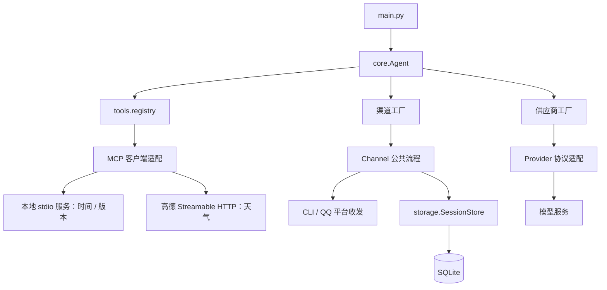
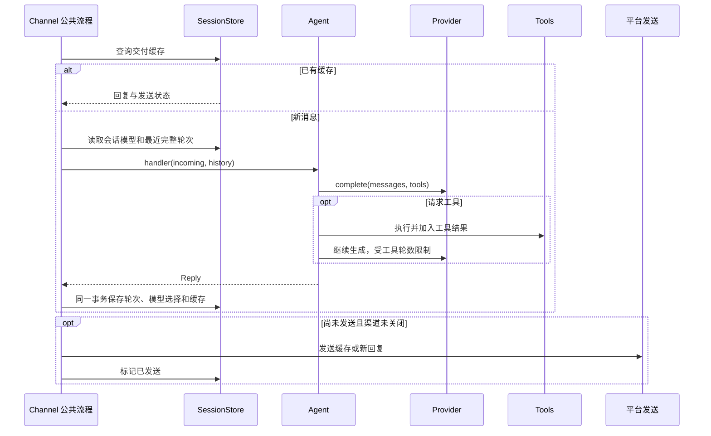

# 架构设计

状态：当前实现与后续设计分开标注，更新于 2026-11-06；用户入口见 [项目 README](../../README.md)，能力演进见 [能力设计](capabilities.md)。

## 目标与范围

当前为单用户优先、单进程、单渠道运行的文本管家。一次 Agent 选择一个渠道；QQ 用户消息全局串行处理，网关接收和心跳独立运行。SQLite 保留历史和交付状态。

架构目标是让新增文本模型供应商或渠道只改各自实现和工厂分支，并为上下文、记忆和工具能力保留明确位置。多租户、分布式队列、动态插件加载和多智能体框架没有当前需求，不建立对应基础设施。

## 模块职责与依赖

图中为创建、调用和资源关系。跨层数据统一放在 models；config 为各层提供已读取的配置。Channel 通过回调调用 Agent，不导入 Agent 实现。

| 模块 | 实际职责 | 边界 |
| --- | --- | --- |
| [main.py](../../main.py) | 参数、日志输出配置、退出码，创建 Agent | 不维护供应商和渠道名单 |
| [config.py](../../ai_butler/config.py) | 集中加载 .env、环境快照、配置归一化和必要校验 | 业务模块不重新读取环境变量 |
| [models](../../ai_butler/models/) | IncomingMessage、Reply、ModelSelection、Delivery 及消息结构 | 不携带连接、客户端或密钥 |
| [core/agent.py](../../ai_butler/core/agent.py) | 生命周期编排、模型选择与缓存、模型和工具循环 | 不直接创建 SessionStore，不处理平台协议 |
| [providers](../../ai_butler/providers/) | 工厂选择、默认配置，独立模型协议适配 | 不读会话库，不处理渠道事件 |
| [channels](../../ai_butler/channels/) | 公共历史、去重、持久化和交付；子类处理平台 I/O | 具体平台不直接操作 SQLite，不导入 Provider |
| [storage](../../ai_butler/storage/) | 表结构、查询、事务、数据库连接释放 | 不调用模型、工具或平台网络接口 |
| [tools](../../ai_butler/tools/) | MCP 服务发现、JSON Schema 校验、执行与资源释放 | 本地时间/版本服务；高德只开放天气，不向外部服务发送模型配置上下文 |

公开运行入口为 Agent 的 run、close、inspect。根目录 main.py 是主要命令行入口；包内 __main__.py 和安装命令 ai-butler 目前仍复用同一 main 函数。下划线模块表达内部约定，不是 Python 的访问控制机制。

## 消息与结果契约

| 数据 | 约定 |
| --- | --- |
| IncomingMessage | 渠道生成 channel、user_id、session_id、text、message_id；公共流程补入已保存的 model |
| ModelSelection | provider 与 model 构成不可变选择，也是 Provider 缓存键 |
| Message | 当前为 dict[str, Any]，内部沿用 role / content / tool_calls / tool_call_id 结构 |
| Reply | text 为发送文本；messages 是本次完整成功轮次；model 非空表示更新会话选择 |
| Delivery | 已生成的回复和 sent 状态，用于平台消息重推时复用 |

Reply.messages 为空时可以发送确认或失败提示，但不加入模型历史。模型切换命令不调用模型，配置验证失败不修改已有选择。切换保留历史；恢复 default 使用本次启动的默认值。

跨渠道命令通过 Agent 的“命令名 → 处理函数”字典分发，当前为 `/model`、`/version`；未知斜杠命令返回帮助提示。CLI 仅拦截帮助、会话、历史和退出等本地交互，其余交给 Agent。命令返回空历史的 Reply，版本查询也不会调用模型。

统一 Message 目前接近 Chat Completions 的文本与函数调用结构。未来 Gemini 等供应商需要在适配器内转换角色、工具 schema、调用标识和工具结果，不能把供应商原始响应直接交给 Agent。新增媒体、流式输出或不同工具语义时，应先扩展统一契约，再调整实现；仅新增子类的承诺适用于现有契约内的能力。

CLI 会话键为 `live:<session>`，QQ 为 `qq:<appid>:c2c:<openid>`。当前没有跨渠道统一用户身份；不同平台的原始用户 ID 不自动视为同一人。

## 一次消息的处理

成功历史按完整轮次保存和裁剪，避免拆散工具调用与结果。最近轮数不等同于输入 token 预算；后者属于待实现的上下文组装能力。

## 持久化与一致性

| 表 | 当前内容 | 一致性约定 |
| --- | --- | --- |
| turns | session_id、messages_json、创建时间 | 仅保存完整成功轮次，按会话和轮次顺序读取 |
| session_models | session_id、provider、model | 与命令确认缓存一起提交 |
| deliveries | message_key、reply、sent | message_key 为 session_id:message_id，无平台 ID 时不去重 |

SessionStore.save 在一个 SQLite 事务内提交上述相关变化，任一写入失败全部回滚。连接在当前处理线程中打开，离开上下文后关闭；不把一个连接跨线程传递。网络和模型调用不包在写事务中。

发送发生在保存之后，mark_sent 是另一笔事务。若发送失败，后续收到同一消息可复用回复而不再次生成。若平台已收到但本地标记失败，存在重复发送窗口；QQ 使用原 msg_id、固定 msg_seq 和平台重复码处理缓解，不承诺跨网络严格恰好一次。

当前 deliveries 没有完整路由、到期时间和重试计划，不足以作为独立 outbox。它也没有启动扫描补发机制。扩展为主动补发前，需要数据库迁移和平台发送规则设计，详见 [运行与可靠性](../guides/operations.md)。

当前建表使用 CREATE TABLE IF NOT EXISTS，没有版本化迁移体系。首次修改已有表时增加显式 schema 版本、升级步骤和回退兼容说明；已有真实数据库不能以删库替代迁移。

## 配置与资源生命周期

1. config.py 加载项目 .env，Config 保存环境快照。通用字段直接访问，专属字段从 options 字典读取；使用 int / float 和 dataclasses.replace，不增加取值包装方法。
2. Agent 初始化时选择 Provider，工厂补齐默认模型和地址并校验，随后创建渠道。QQ 在自身初始化入口调用 validate_qq。导入模块不要求密钥有效；仅做渠道诊断时不创建模型。
3. Agent 按 ModelSelection 复用 Provider。运行期配置视为启动快照，修改 .env 后重启生效。
4. QQGateway 维护连接、登录、心跳和重连；QQChannel 管理一个工作线程和总量 16 的在途/排队名额。模型耗时不阻塞心跳。
5. Agent.run 的 finally 调用 close；Channel 设置停止事件，QQ 关闭网关、取消排队任务并等待当前工作结束。当前同步 HTTP 请求不能即时取消，Linux SIGTERM 也尚未接入该关闭流程。
6. ToolRegistry 按需建立 MCPClient；每个连接用 AnyIO 后台事件循环持有异步 Client，同步 Agent 经 portal 调用。stdio 使用当前解释器启动本项目服务，远端使用 Streamable HTTP；退出时关闭渠道后在 finally 释放所有 MCP 连接、子进程和线程。

工具的描述与执行连接来自同一份服务发现结果，Tool dataclass 保存描述、客户端与是否携带本地版本上下文。模型标识/配置版本通过 MCP 请求元数据传给本地服务，不作为模型参数，也不发给高德。注册时拒绝重名；天气发现失败保留本地工具。具体配置与版本语义见 [MCP 接入](../guides/mcp.md)。

配置错误使用 ValueError，模型与业务运行失败使用 RuntimeError。Provider 处理网络、JSON 和安全错误提示；Channel 统一转换存储异常。QQ 向用户发送简短失败提示，CLI 可以呈现具体的安全提示。未知工作线程异常只记录固定日志，当前不保证向用户补发失败说明。

## 扩展约定

| 扩展 | 需要修改 | 需要验证 |
| --- | --- | --- |
| 新供应商 | 独立 Provider 子类、工厂导入和 _provider_type 分支 | 请求、认证、角色和工具转换、错误、重试及模型切换 |
| 新渠道 | 独立目录、Channel 子类、工厂导入和 _channel_type 分支 | 用户与会话隔离、消息键、缓存重推、关闭、诊断 |
| 新工具 | 本地 MCP 服务的工具函数，或 tools 层新增服务器连接与明确允许列表 | 发现与执行一致、重名、参数、失败、关闭；有副作用时另定义授权和幂等 |
| 新持久数据 | models 数据契约与 storage 的查询、迁移和事务 | 旧库升级、失败回滚、恢复、跨用户隔离 |

新渠道构造器默认接收 Config，实现 _receive(handler)、_send(incoming, text)，按需实现 _close 和 inspect；统一消息交给 _process。CLI 的 session 构造参数目前由工厂特殊处理，属于已有终端配置。

Provider 子类声明 default_model、default_base_url；工厂按 NAME_API_KEY / NAME_MODEL / NAME_BASE_URL 读取选项。当前采用 API Key + HTTPS 配置约定；未来 OAuth、区域端点等不同认证需求应在对应实现中补充配置解析，而非把供应商分支放回 Agent。

新增实现需要导入与一个选择分支；不修改 Agent、CLI 路由或会话存储的名单。第三种 Provider + Channel 的流程测试已经验证这一边界，但不代表真实第三方协议已接入。

## 架构决策与完整性

| 决策 | 理由 | 重新评估条件 |
| --- | --- | --- |
| Agent 门面，内部简单工厂 | 统一入口和选择，新增实现可控 | 出现第三方动态安装需求 |
| Provider 策略/适配器 | 隐藏不同供应商协议 | 新能力超出现有 Message 契约 |
| Channel 模板方法 | 去重、历史和保存规则只维护一份 | 主动任务不能自然映射为入站回复时单独设计投递用例 |
| 单进程、QQ 串行、SQLite | 个人负载下保持顺序和事务简单 | 可测量的排队延迟或多用户并发需求 |
| 人设、记忆、Skill 按需增加 | 先定义数据和用例，避免空壳框架 | 对应阶段的真实任务开始实现 |

完整性缺口及验收条件由 [演进与验收](../plans/roadmap.md) 统一跟踪。设计变更先写明触发场景、责任归属、数据/失败语义和验证方式，再决定是否需要新模块或接口。
